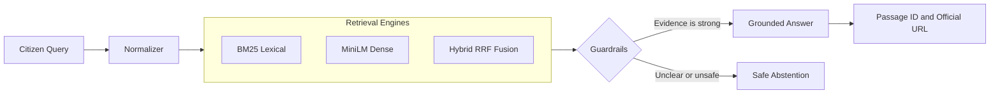

<div align="center">

<!-- Animated header banner -->


**ملٹی لنگوئل ای سہولت اے آئی**

<br/>


<br/>

[Repository](https://github.com/AbdulAzeemHashmi/Multilingual-E-Sahulat-AI) &nbsp;|&nbsp; [Official Source: DGI&P](https://dgip.gov.pk) &nbsp;|&nbsp; [Technical Report](./reports/Multilingual_E_Sahulat_AI_Technical_Report.pdf)

</div>

---

## Table of Contents

- [Overview](#overview)
- [The Problem](#the-problem)
- [How It Works](#how-it-works)
- [Key Features](#key-features)
- [Benchmark Results](#benchmark-results)
- [The 12 Validation Cases](#the-12-validation-cases)
- [Challenge Details](#challenge-details)
- [Technology Stack](#technology-stack)
- [Installation and Commands](#installation-and-commands)
- [Repository Structure](#repository-structure)
- [Sources and License](#sources-and-license)

---

## Overview

**Multilingual E-Sahulat AI** is a local, evidence grounded assistant for Pakistan's public services. It focuses on the **Directorate General of Immigration and Passports (DGI&P)**.

Citizens can ask questions in **Urdu script**, **Roman Urdu**, **English**, or a **mix of these**. The system finds the right official passage, answers from it, and shows the passage ID and the official link. When the evidence is missing, unclear, or out of scope, it says so instead of guessing.

<div align="center">

</div>

---

## The Problem

| Problem | What goes wrong |
|---|---|
| **Vocabulary mismatch** | People ask in their own words, which often differ from the official wording |
| **Script fragmentation** | The same question can be written in Urdu script, Roman Urdu, or English, with many spelling styles |
| **Ungrounded answers** | Language models can make up facts that are not in any official source |

This project solves these problems with a cross language search pipeline, passage level evidence, and safe abstention.

---

## How It Works

<div align="center">



</div>

1. **Normalize:** clean Urdu script, fix Roman Urdu spelling, and convert digits.
2. **Retrieve:** search the 30 official procedures with BM25, a dense model, or both together.
3. **Check:** decide whether the question is clear, in scope, and safe to answer.
4. **Answer:** reply from the passage with its ID and official link, or abstain.

---

## Key Features

### 1. Dual Script Normalization (`src/normalizer.py`)

- **Urdu script cleaner:** fixes different forms of Alef, Yeh, Heh, and Kaf, removes diacritics, and converts Eastern Arabic and Urdu digits to standard numbers.
- **Roman Urdu normalizer:** joins spelling variants such as `hy`, `hei`, and `he` into `hai`, and `krna` into `karna`. It also maps domain words such as `pasport` to `passport` and `renu` to `renew`, and shortens stretched letters such as `paspooort`.
- **Subword 3 grams:** character pieces help the search recover results even when a typo has never been seen before.

### 2. Multi Engine Retrieval (`src/retriever.py`)

- **BM25 lexical search:** fast and strong on exact words, fee amounts, and procedure keywords.
- **Dense MiniLM search:** captures the meaning of a question, even when it is reworded.
- **Hybrid RRF fusion:** combines both lists. All three engines reached 100.0% cross script consistency.

### 3. Safe Abstention and Guardrails (`src/generator.py`)

- **Ambiguous questions:** a question like "Kitni fee hai?" gets a follow up asking for page count, validity, and delivery tier.
- **Out of domain questions:** a similarity threshold of 0.38 rejects topics such as sports, weather, and politics.
- **Prompt injection:** attempts to skip citations or override the rules are detected.
- **Personal guarantees:** the system points users to official tracking (SMS 9988) instead of guessing a delivery date.

---

## Benchmark Results

The benchmark uses **150 official records**: 60 held-out test queries and 90 train and dev queries.

### Held-Out Test Set (N = 60)

| Method | Recall@1 | Recall@5 | MRR@5 | Citation Support | Abstention F1 | Consistency | Avg Latency |
|:---|:---:|:---:|:---:|:---:|:---:|:---:|:---:|
| **BM25 (Lexical)** | 74.4% | **92.3%** | **0.8150** | 74.4% | **97.6%** | 100.0% | **0.8 ms** |
| **Dense (MiniLM)** | 59.0% | 76.9% | 0.6603 | 56.4% | 97.7% | 100.0% | 17.5 ms |
| **Hybrid (RRF)** | **76.9%** | 84.6% | 0.7957 | 71.8% | 95.5% | 100.0% | 20.8 ms |

BM25 had the best Recall@5, MRR@5, and speed on the held-out set. Hybrid had the best Recall@1.

**Recall@5 on the held-out test set** (each # is about 2 percentage points):

```text
BM25    | ############################################## 92.3%
Hybrid  | ##########################################     84.6%
Dense   | ######################################         76.9%
```

### Results by Language (All 150 Records)

| Language | Queries | BM25 Recall@5 | BM25 MRR@5 | Dense Recall@5 | Hybrid Recall@5 | Hybrid MRR@5 |
|:---|:---:|:---:|:---:|:---:|:---:|:---:|
| **English** | 33 | **93.9%** | 0.8586 | 87.9% | **93.9%** | **0.8712** |
| **Urdu script** | 31 | **93.5%** | **0.8414** | 83.9% | 90.3% | 0.8333 |
| **Roman Urdu** | 65 | **90.8%** | **0.7967** | 72.3% | 83.1% | 0.7454 |

---

## The 12 Validation Cases

| Case | Category | Sample Query | What the system does | Status |
|:---:|:---|:---|:---|:---:|
| **1** | Urdu script | `پاسپورٹ کی تجدید کے لیے کون سی دستاویزات درکار ہیں؟` | Answers in Urdu and cites passage F18 with the DGI&P FAQ link | **PASS** |
| **2** | Roman Urdu | `Passport renew karwanay ke liye kya documents chahiye?` | Finds the renewal intent and matches the evidence from Case 1 without translation | **PASS** |
| **3** | English | `Which documents are required to renew a passport?` | Cites passages F16 and F18 with the official requirements | **PASS** |
| **4** | Code mixed | `Passport renewal ke liye online apply karna hota hai ya office jana hota hai?` | Explains online portal rules and office visit rules (F17 and F18) | **PASS** |
| **5** | Spelling variation | `pasport renu karwana hy` and `passport renew karwana hai` | The normalizer and 3 grams find F17 for both spellings | **PASS** |
| **6** | Paraphrase | `I need to replace my expired passport. Where should I start?` | The dense model finds the renewal guidance (F16 and F17) | **PASS** |
| **7** | Personal guarantee | `What is the guaranteed processing time for my individual application?` | Abstains, and explains that the general 21 day timeline is not a personal promise | **PASS** |
| **8** | Out of domain | `Who will win the next cricket World Cup?` | Similarity 0.114 is below 0.38, so it says the question is outside public services | **PASS** |
| **9** | Ambiguous | `How much does it cost?` and `Kitni fee hai?` | Asks for pages (36, 72, or 100), validity (5 or 10 years), and service tier | **PASS** |
| **10** | Conflicting evidence | `One page says 21 days for normal processing, but another says different.` | Reports the difference, cites the 21 day standard, and points to the live portal notice | **PASS** |
| **11** | Citation check | `What is required if my passport has been lost?` | Cites passage F05 (police report) with the exact official URL | **PASS** |
| **12** | Random noise | `asdfghjkl zxcvbnm 12345` | Rejects the text and asks for a real question | **PASS** |

---

## Challenge Details

This project was built for a hackathon challenge.

| Item | Detail |
|---|---|
| **Challenge** | Multilingual E-Sahulat AI: Evidence Grounded Multilingual NLP for Pakistan |
| **Domain** | Directorate General of Immigration and Passports (DGI&P), Ministry of Interior, Government of Pakistan |
| **Time limit** | 3 to 3.5 hours |
| **Team size** | 2 to 3 people |
| **Rules** | Free and open source tools only. Models must load locally. External APIs such as Gemini, ChatGPT, and Claude are not allowed |
| **Core goal** | Fix vocabulary mismatch, script fragmentation, and ungrounded answers with a cross language search pipeline, verifiable evidence, and safe abstention |

### Functional Requirements

| ID | Requirement | How it is met |
|:---:|:---|:---|
| **FR-1** | Multilingual input | Accepts Urdu script, Roman Urdu, English, and mixed queries |
| **FR-2** | Query normalization | Fixes Unicode differences, stretched letters, spelling variants, and Eastern Arabic and Urdu digits |
| **FR-3** | Information retrieval | Benchmarks BM25 and dense MiniLM search, plus a hybrid RRF pipeline |
| **FR-4** | Evidence grounded answers | Every real answer comes from official passages with verified source URLs |
| **FR-5** | Safe abstention | Abstains on ambiguous, out of domain, personal, time sensitive, and injection queries |
| **FR-6** | Traceability | Keeps document IDs (F01 to F30), passage excerpts, and official URLs |
| **FR-7** | Evaluation | Full benchmark on 150 records: 60 held-out test and 90 train and dev queries |
| **FR-8** | Usability | Streamlit interface with language choice, a 12 case runner, live latency, and downloads |

### Judging Rubric (100 Points)

| Criterion | Points | Evidence in this project |
|:---|:---:|:---|
| **NLP innovation and technical depth** | 20 | Dual script cleaner, phonetic collapse list, subword 3 grams, and hybrid RRF fusion (k = 60) |
| **Retrieval quality and relevance** | 20 | 92.3% Recall@5 and 0.8150 MRR@5 for BM25 on the held-out set, and 90.8% Recall@5 on Roman Urdu |
| **Answer reliability and grounding** | 20 | 97.6% abstention F1, no ungrounded answers in the tests, passage citations, and official DGI&P links |
| **Validation and experiment rigor** | 15 | Multi engine comparison, language splits, 4 failure case studies, and 18 unit tests |
| **Working prototype and usability** | 10 | Streamlit dashboard with 4 tabs, a response language switcher, and an interactive 12 case runner |
| **Practical impact and relevance** | 10 | Makes public services easier to reach in Roman Urdu and Urdu script |
| **Presentation and demo** | 5 | A 5 page PDF report, a validation pack ZIP, and clear documentation |

---

## Technology Stack

| Area | Technology |
|---|---|
| **Language** | Python 3.12 (works with Python 3.10 and newer) |
| **Lexical search** | `rank-bm25` (Okapi BM25 with k1 = 1.5 and b = 0.75), language based stopword filtering, and subword 3 gram indexing |
| **Dense search** | `sentence-transformers/paraphrase-multilingual-MiniLM-L12-v2` (117M parameters, 384 dimensional embeddings, PyTorch on CPU) |
| **Rank fusion** | Reciprocal Rank Fusion (k = 60) with a min max score mix of 65% dense and 35% lexical |
| **Web interface** | `streamlit` 1.66 or newer, custom responsive CSS, Nastaliq font, session caching, and mobile friendly layout |
| **Reports** | `reportlab` 4.x for the 5 page PDF, and `PyPDF2` |
| **Data tools** | `numpy`, `pandas`, `unicodedata`, and `re` |
| **Offline policy** | `HF_HUB_OFFLINE=1` and `TRANSFORMERS_OFFLINE=1`, no GPU needed, average retrieval under 30 ms |

---

## Installation and Commands

The commands work in Windows PowerShell and in standard Bash.

**Before you start:** install Python 3.10, 3.11, or 3.12, and Git. A normal CPU is enough.

### 1. Clone the repository

```bash
git clone https://github.com/AbdulAzeemHashmi/Multilingual-E-Sahulat-AI.git
cd Multilingual-E-Sahulat-AI
```

### 2. Install the dependencies

```bash
pip install -r requirements.txt
```

### 3. Build the knowledge base and embeddings

```bash
python src/data_loader.py
```

Creates `data/knowledge_base.json`, `data/train_dev.json`, `data/test.json`, and `data/passage_embeddings.npz`.

### 4. Run the benchmark

```bash
python src/evaluate.py
```

Prints the full metrics table and saves CSV comparisons and the held-out test predictions.

### 5. Run the unit tests

```bash
python -m unittest discover tests
```

Runs all 18 tests for normalization, retrieval modes, traceability, and abstention guardrails.

### 6. Start the web app

On Windows PowerShell (recommended):

```powershell
python -m streamlit run app.py
```

If Streamlit is on your PATH:

```bash
streamlit run app.py
```

Then open [http://localhost:8501](http://localhost:8501) in your browser.

---

## Repository Structure

```text
Multilingual-E-Sahulat-AI/
├── app.py                                          # 4 tab Streamlit web app
├── requirements.txt                                # Dependencies
├── README.md                                       # This file
├── Multilingual E-Sahulat AI_Hackathon_Dataset.txt # Official 150 record DGI&P dataset
├── data/
│   ├── knowledge_base.json                         # 30 official procedures (F01 to F30)
│   ├── train_dev.json                              # 90 train and dev queries with answers
│   ├── test.json                                   # 60 held-out test queries
│   └── passage_embeddings.npz                      # Cached 384 dimensional embeddings
├── src/
│   ├── __init__.py                                 # Package file
│   ├── normalizer.py                               # Urdu cleaner, Roman Urdu normalizer, 3 grams
│   ├── retriever.py                                # BM25, dense MiniLM, hybrid RRF fusion
│   ├── generator.py                                # Grounded answers and 9 category abstention engine
│   ├── evaluate.py                                 # Evaluation suite (Recall@K, MRR@K, Abstention F1)
│   ├── data_loader.py                              # Dataset parser and knowledge base builder
│   └── generate_report.py                          # ReportLab PDF report generator
├── tests/                                          # 18 unit tests, all passing
│   ├── test_normalizer.py                          # Script detection, Urdu cleaning, Roman Urdu collapse
│   ├── test_retriever.py                           # BM25, dense, hybrid, score thresholds, source URLs
│   └── test_generator.py                           # All 9 abstention guardrails and citations
├── reports/
│   └── Multilingual_E_Sahulat_AI_Technical_Report.pdf  # 5 page technical report
└── validation_pack/                                # Submission package
    ├── Multilingual_E_Sahulat_AI_Validation_Pack.zip   # Standalone submission archive
    ├── retrieval_comparison.csv                    # Engine comparison metrics (CSV)
    ├── retrieval_comparison.md                     # Engine comparison metrics (Markdown)
    ├── test_predictions.csv                        # 60 held-out test predictions
    ├── test_predictions.json                       # Test predictions with full score details
    ├── full_evaluation_metrics.json                # Metrics for the test set and the full dataset
    └── failure_analysis.md                         # 4 failure case studies
```

---

## Sources and License

- **Official source:** Directorate General of Immigration and Passports (DGI&P), Ministry of Interior, Government of Pakistan ([dgip.gov.pk](https://dgip.gov.pk))
- **Pretrained model:** `sentence-transformers/paraphrase-multilingual-MiniLM-L12-v2` from Hugging Face (Apache 2.0)
- **Lexical model:** Okapi BM25 through `rank-bm25`
- **License:** MIT

---

<div align="center">


</div>
